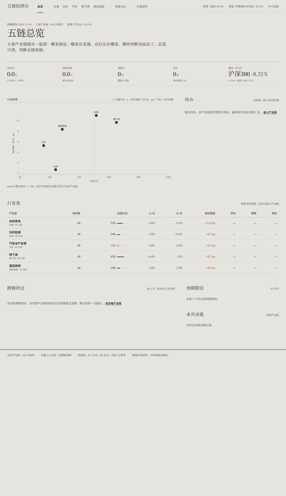
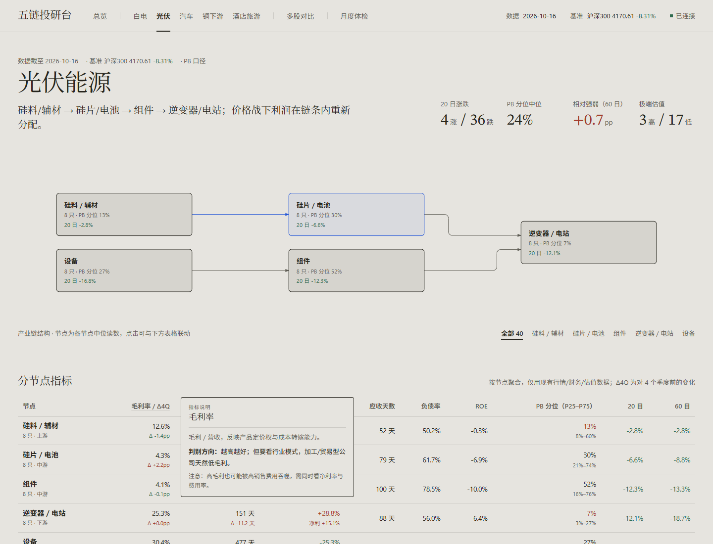

# 五链投研台

> 白电 / 光伏能源 / 汽车全产业链 / 铜下游 / 酒店旅游，五条产业链、每链 40 只、共 200 只 A 股。
> **纯人工分析**：以「月」为最短持有周期，重行业位置、公司逻辑、估值分位与假设兑现；
> 不做量化因子、不做回测、不接大模型。本地 Web 应用，数据与判断全部留在本机。



---

## 0. 30 秒认识

| 层 | 是什么 | 存在哪 |
|---|---|---|
| 数据 | 200 只 + 沪深300 日线、季度财务、PE/PB/PS/EV/EBITDA、三表/ROIC/FCF、主营构成/海外占比、期货/宏观代理 | `data/*.parquet` |
| 判断 | 每只标的的逻辑卡、可证伪假设、决策流水与快照、持仓、月度复盘 | `data/state.sqlite` |
| 界面 | 总览 / 单链 / 标的活文档 / 月度体检 四个只读+人工录入页面 | `web/`（无构建、离线） |

**四条硬规则**

1. 先有逻辑，再谈仓位；
2. 每条逻辑至少有一条**可被证伪**的假设（指标 + 目标 + 截止日）；
3. 每次买入/加仓/减仓/清仓必须留下**决策快照 + sha256**；
4. 每月体检必须处理：到期假设、估值极端、待办；写下的复盘才算数。

核心链路：

```
采数 ──▶ 总览（哪条链便宜/走强/仓位在哪）
          │
          ▼
       单链（产业链图 + 40 只标的 + 分节点指标 + 估值分布）
          │
          ▼
       标的活文档：写逻辑卡 ──▶ 写可证伪假设
          │                         │
          ▼                         ▼
       记录决策（快照 + 哈希）      到期/证伪进入收件箱
          │                         │
          ▼                         ▼
       持仓与归因 ──────────▶ 月度体检（假设/极端/待办）
                                      │
                                      ▼
                              复盘正文 + 导出 Markdown
                                      │
                                      ▼
                              下一轮修正（逻辑卡留版本）
```

---

## 1. 五条产业链

| 链 | id | 标的数 | 估值口径 | 节点 |
|---|---|---|---|---|
| 白色家电 | `whites` | 40 | PE | 上游零部件 / 整机·空冰洗 / 厨电 / 小家电 / 清洁电器 |
| 光伏能源 | `pv` | 40 | PB | 硅料·辅材 / 硅片·电池 / 组件 / 逆变器·电站 / 设备 |
| 汽车全产业链 | `auto` | 40 | PE | 电池·零部件 / 整车 / 智能化·服务 |
| 铜下游 | `copper` | 40 | PB | 铜矿·冶炼 / 铜加工 / 电缆 / 电网·终端 |
| 酒店旅游 | `tourism` | 40 | PE | 酒店运营 / 景区目的地 / 旅游服务·免税 |

标的池、节点、KPI 定义全部在 [`config/chains.json`](config/chains.json)。每条链另有 4 个行业 KPI 定义（白电：空调排产/竣工/铜价/出口；光伏：硅料、组件价格/装机/出口；汽车：零售/渗透率/出口/锂价；铜：沪铜/铜杆开工/电网投资/竣工；酒店：RevPAR/民航客流/景区客流/免税销售）——**目前只是定义，尚未接入真实行业数据**，链读数暂由成分股聚合，详见 §3。

> **本轮池子已从每链 20 只扩到 40 只（共 200 只）**，节点分布：白电 8/8/8/8/8；光伏 8/8/8/8/8；汽车 13/13/14；铜下游 8/10/11/11；酒店旅游 12/13/15。新增标的按 `核心可买 / 潜在成长 / 产业观察` 三个维度补齐；这三类角色尚未写入数据，计划由场外 Skill 生成候选、人工确认后再落库（见 §9.1）。单链原则上不超过 50 只。

---

## 2. 快速开始

```powershell
cd D:\股市

# 1) 初始化（建状态库；无数据时自动采集，约 10 分钟）
.venv\Scripts\python.exe scripts\bootstrap.py

# 2) 启动（推荐：后台起服务 + 健康检查 + 预热缓存 + 自动打开浏览器）
.\scripts\start.bat
# 或手动：.venv\Scripts\python.exe -m uvicorn app.server:app --host 127.0.0.1 --port 8000

# 3) 打开
#    总览        http://127.0.0.1:8000/#/overview
#    单链        http://127.0.0.1:8000/#/chain/pv
#    活文档      http://127.0.0.1:8000/#/stock/600438.SH
#    多股对比    http://127.0.0.1:8000/#/compare?symbols=600438.SH,000333.SZ,601899.SH
#    月度体检    http://127.0.0.1:8000/#/review
```

数据刷新：

```powershell
# 全部五链（并发，约 3–5 分钟）
.venv\Scripts\python.exe -m data_engine.fetch_chains --workers 6
# 只补缺失标的（日常增量）
.venv\Scripts\python.exe -m data_engine.fetch_chains --only-missing --workers 6
# 只刷一条链
.venv\Scripts\python.exe -m data_engine.fetch_chains --chain copper
# 主营构成/主营介绍（约 4 分钟，200 只）
.venv\Scripts\python.exe -m data_engine.fetch_business
# 估值/分红/预测（约 5 分钟）
.venv\Scripts\python.exe -m data_engine.fetch_valuation_ext
# 三表/财务指标（约 5 分钟）
.venv\Scripts\python.exe -m data_engine.fetch_financial_ext
# 股东户数（约 3 分钟）
.venv\Scripts\python.exe -m data_engine.fetch_chips
# 期货/铜库存/宏观代理（约 2 分钟）
.venv\Scripts\python.exe -m data_engine.fetch_macro
# 服务已启动时热加载
curl.exe -X POST http://127.0.0.1:8000/api/reload
```

自检与测试：

```powershell
.venv\Scripts\python.exe scripts\check_env.py
.venv\Scripts\python.exe -m pytest -q          # 16 个用例
.venv\Scripts\python.exe scripts\e2e_check.py  # Playwright + 本机 Edge
```

> 交付状态：`data/state.sqlite` 是**干净**的（0 持仓 / 0 逻辑 / 0 待办），打开即可录入自己的判断；行情数据为真实 AkShare，截至 2026-10-16。

---

## 3. 决策链路（逐段说明）

### 3.1 第 0 步：数据准备（盘后/按需）

采集脚本 `data_engine/fetch_chains.py` 遍历 `config/chains.json` 中的 200 只标的 + 沪深300：

| 数据 | 频率 | 字段 | 来源 |
|---|---|---|---|
| 行情 | 日 | 开高低收、成交量、成交额、换手率（前复权） | 新浪 `stock_zh_a_daily`，腾讯 `stock_zh_a_hist_tx` 回退 |
| 财务 | 季度 | 营收/净利同比、毛利率、净利率、ROE、库存/应收天数、资产负债率 | 同花顺摘要 `stock_financial_abstract_ths`，指标接口回退 |
| 估值 | 日 | PE(TTM)、PB、近 1/3 年分位 | 百度股市通 `stock_zh_valuation_baidu` |
| 舆情 | 日快照 | 综合得分、关注指数、机构参与度 | 东财千股千评 `stock_comment_em` |
| 主营构成 | 近 5 年各期 | 按产品/按地区收入、收入占比、毛利率；主营介绍 | 东财 `stock_zygc_em` + 同花顺 `stock_zyjs_ths` |
| 市值/估值扩展 | 日 | 总市值/流通市值/股本、PS、市现率、PEG、PE(EM)、PB(EM) | 东财 `stock_value_em` |
| 三表/财务指标 | 年报/季度 | ROIC、单季营收/扣非同比、CCC、FCF、Capex、CIP、净资产、有息负债、减值 | 东财三表 + `stock_financial_analysis_indicator_em` |
| 分红/预测 | 年度/快照 | 每股派息、股息率；研报数、2026–2028 预测 EPS、forward PE | `stock_history_dividend_detail` + `stock_profit_forecast_em` |
| 筹码 | 季度 | 股东户数、户数环比、户均持股市值 | `stock_zh_a_gdhs_detail_em` |
| 期货/宏观代理 | 日/月 | CU0/LC0/SI0、铜库存、社零/用电/客座率/民航周转 | `futures_main_sina` + `macro_china_*` |
| 基准 | 日 | 沪深300 收盘 | 新浪 `stock_zh_index_daily` |

- 原子写 Parquet（`.tmp` → `os.replace`），失败不破坏旧文件；
- 支持按链增量合并（`--chain`），单标的失败只记错误，不中断其它；
- 前端通过 `/api/reload` 热加载，无需重启服务。

### 3.2 第 1 步：总览扫描（每周 10 分钟 / 每月初）

入口：`#/overview`。**只读，不在这里编辑判断。**

看四样东西：

1. **组合条**：总仓位、加权浮盈、逻辑卡数量、待办数量、基准近 20 日；
2. **行业象限**（唯一大图）：
   - x = 该链 40 只标的的**估值分位中位**（白电/汽车/酒店用 PE，光伏/铜用 PB）；
   - y = 该链**60 日相对沪深300**（链中位收益 − 基准收益，pp）；
   - 气泡大小 = 该链持仓权重；红点 = 该链待办 ≥ 3 条；
   - 点击气泡/行业表行进入对应链。
3. **行业表**：标的数、估值分位、20 日、60 日、相对强弱、持仓、逻辑数、待办；
4. **跨链持仓 / 待办 / 30 天内到期假设 / 本月决策**。

这一步的产出不是交易，而是**注意力分配**：哪条链估值在低位但相对强度转正、哪条链仓位过重、哪条链假设集中到期。

### 3.3 第 2 步：单链研究（进入 `#/chain/{id}`）

- **产业链图**：该链 5 个（或 3/4 个）节点，节点上显示标数、估值分位中位、20 日中位；正交连线，节点/文字可筛选下方表格。
- **六条链读数**（当前是成分股聚合，不是真实行业 KPI）：
  1. 估值分位中位（按该链口径）；
  2. 毛利率中位与较 4 个季度前变化（pp）；
  3. 库存周转天数中位与变化；
  4. **上游−下游毛利率差**（链内利润分配代理：上游/下游成分股中位差，含 4 季变化）；
  5. 20 日涨跌家数；
  6. 60 日相对沪深300。
- **分节点指标**：每个节点的毛利率/Δ4Q、库存天数/Δ4Q、营收/净利增速、应收天数、负债率、ROE、估值分位（P25–P75）、20/60 日。节点之间不共用同一套阈值，用于判断“利润在链条哪一段沉淀”。
- **分节点估值与质量**：ROIC、CCC、FCF 收益率、远期 PE、股息率、海外收入占比；用于区分“真低估”和“低 PB/低 PE 陷阱”。
- **外部代理**：沪铜/碳酸锂/工业硅期货、铜库存、社零/用电/民航客座率；只作为代理读数，标 `as_of`，不是真实行业 KPI。
- **40 只标的表**：名称/代码、位置（上游/中游/下游）、现价、20/60 日、PE 或 PB、近三年分位、毛利率、营收增速、库存天数、我的状态、假设提醒。点击行进入活文档。
- **估值分布**：按节点分组的小提琴/点图，用来判断“整条链都贵/便宜”还是“只有某一段极端”。

这一步的产出是**候选名单与产业链位置判断**：利润在链上哪个环节、哪个环节的估值与景气错位。

### 3.4 第 3 步：建逻辑卡（`#/stock/{symbol}` → 我的逻辑）

每只标的只有一张逻辑卡（`theses` 表，`symbol` 唯一），字段：

| 字段 | 说明 | 必填 |
|---|---|---|
| 状态 | 观察 / 分批建仓 / 持有 / 已减仓 / 已结案 | 是（默认观察） |
| 一句话标题 | 这笔投资的“标题” | 建议 |
| 核心逻辑 | 为什么买、关键变量、为什么不买 | 建议 |
| 估值看法 | 什么价格算便宜/贵 | 建议 |
| 持有周期 | 例如 6–12 个月，决定用哪张财报验证 | 建议 |

保存走 `POST /api/thesis`。更新时旧版本自动写入 `thesis_versions`，可回溯“当时怎么想”。

**状态机**（人工为主，决策会自动推进部分状态）：

```
观察(watch) ──买入/加仓──▶ 持有(holding) ──减仓──▶ 已减仓(reduced) ──清仓──▶ 已结案(closed)
   │                          ▲
   └──── 人工设为「分批建仓(building)」──┘
```

- 人工可在状态机里切换任意状态；
- `POST /api/decision` 的 `buy/add` 会把 `watch/closed` 推进到 `holding`；`reduce` → `reduced`；`exit` → `closed`；
- `building` 需要人工设置（用于“计划分批但还没买满”）。

**活文档还包含（只读）：**

- **收盘价**：近三年日线，最高/最低价各画一条虚线横线，并标注区间最高/最低；
- **主营构成**：最新报告期按产品/按地区，显示收入、收入占比、毛利率；附海外收入占比、同比变化与海外毛利率；
- **估值与质量**：总市值、PS、股息率、ROIC、FCF 收益率、净负债率、单季营收/扣非、Forward PE、现金/短债、海外收入、股东户数环比；
- **财务趋势**：近 10 个季度营收/净利同比、毛利率、库存天数（右轴）。

### 3.5 第 4 步：写可证伪假设（假设清单）

每张逻辑卡下可写多条假设（`assumptions`），字段：

| 字段 | 例子 |
|---|---|
| 假设陈述（必填） | “Q3 毛利率同比提升 0.5pp 以上” |
| 指标 | 销售毛利率 |
| 目标 | ≥27.3% |
| 截止日 | 2026-10-31 |
| 范围 | 个股 / 行业（行业假设用于链上共享变量） |
| 状态 | 待验证 / 进行中 / 已兑现 / 已证伪 |
| 证据 | Q3 毛利率 27.6%，超预期 |

规则：

- **没有假设的逻辑卡不算完整**：月度体检会提醒；
- 假设状态人工更新（`PATCH /api/assumption/{id}`），不做自动 NLP；
- 进入收件箱的条件（`/api/inbox`）：
  - 状态 = 已证伪 → **高危**；
  - 状态 = 待验证/进行中 且 截止日已过 → 待办；
  - 该标的已建立逻辑/持仓，且估值分位 ≥85% 或 ≤15% → 估值提醒（避免 200 只全量刷屏）。

### 3.6 第 5 步：记录决策（强制留痕）

在活文档底部「决策记录」填写：

| 字段 | 说明 |
|---|---|
| 类型 | 观察 / 买入 / 加仓 / 减仓 / 清仓 |
| 成交价/现价 | 默认当前价，可改 |
| 计划仓位 % | 按仓位百分比管理（不记股数） |
| 理由（必填） | 为什么在此时做这个动作 |
| 证伪条件 | 出现什么情况说明这次判断错了 |

提交走 `POST /api/decision`，服务端做三件事：

1. **生成不可改快照**（`decisions.snapshot_json`）：时间、标的、链、动作、价格、仓位、理由、证伪条件、估值口径与分位、PE/PB、毛利率、营收/净利增速、库存天数、20/60 日涨跌；
2. **计算 sha256**（`snapshot_hash`）并落库；
3. **更新持仓与逻辑状态**：
   - `buy/add`：不存在持仓则新建；已存在则按仓位加权计算新成本，仓位相加；逻辑状态转 `holding`；
   - `reduce/exit`：降低/清零仓位；状态转 `reduced/closed`。

`decisions` 表没有 update 接口，历史决策只能新增、不能改写。

### 3.7 第 6 步：持有期（不做日频盯盘）

- 每天只看**收件箱**：证伪/过期假设、已跟踪标的的估值极端；
- 每周更新一次逻辑卡（可选）与假设证据；
- 价格和净值只在活文档里看，不作为每日交易信号；
- 新增决策就会产生新的快照，形成“何时、基于什么数据、做了什么判断”的完整流水。

### 3.8 第 7 步：月度体检（`#/review`）

每月固定一次（财报季/重大事件可加一次），页面包含：

1. **组合摘要**：持仓数、总仓位、按仓位加权浮盈、逻辑卡数；
2. **行业分布**：按链汇总持仓权重；
3. **假设看板**：全部逻辑卡 + 假设，按状态分组；
4. **估值极端名单**：全市场按链口径，最多列 8 高 + 8 低，同时显示全量计数（`valuation_flag_totals`）；可按链过滤（过滤时为该链内统计）；
5. **45 天内到期/已过期假设**；
6. **本月决策流水**；
7. **月度复盘编辑框 + 导出 Markdown**（`GET /api/export/review?month=&chain=`）。

体检的产出是一份**可留档的月报**：组合结果、假设兑现/证伪、估值状态、下月待办。

### 3.9 第 8 步：复盘与迭代

- 在复盘正文里写：判断对错、偏差原因、下月待办；
- 逻辑卡需要修订时直接保存，旧版本进 `thesis_versions`；
- 不做“自动改写逻辑”或“自动建议买卖”；系统只负责让数据、假设与决策在同一页面对齐。

### 3.10 节奏建议

| 频率 | 时长 | 动作 |
|---|---|---|
| 每日 | 5–10 分钟 | 只看收件箱；触发型事件才处理 |
| 每周 | 30 分钟 | 总览扫一眼、更新假设证据、补到期日 |
| 每月 | 2–3 小时 | 月度体检、复盘、调仓决策、导出月报 |
| 每季 | 财报后 | 验证假设、修订逻辑卡（留版本） |

### 3.11 本地缓存与数据刷新 Skill

页面/API 只读本地文件；为避免每次重新计算，新增 `data/cache.sqlite` 缓存 **接口返回的 JSON**：

- 首次访问总览/单链约 2–3 秒，之后命中缓存 **3–5 毫秒**；
- 缓存键含数据版本（Parquet/SQLite 文件 mtime），数据变化或 `POST /api/reload` 自动失效；
- `scripts/start.bat` 启动后台服务、健康检查、`POST /api/warm?full=1` 预热总览/五链/体检/全部标的，再打开浏览器；
- 前端 `web/js/prefetch.js` 在页面加载后按空闲顺序预取总览、五链、体检和全部 200 只活文档，进度写入 `data-prefetch`；
- `data/raw_http_cache.sqlite` 是 AkShare 原始 HTTP 缓存：**同一 URL 同一自然日只真正请求一次**；`AK_CACHE_DISABLE=1` 可强制绕过；
- `_skills/data-refresh/scripts/refresh.py` 按 TTL 跑过期数据集，更新 `data/fetch_manifest.json`，完成后自动 reload + warm。

```powershell
.venv\Scripts\python.exe _skills\data-refresh\scripts\refresh.py --status
.venv\Scripts\python.exe _skills\data-refresh\scripts\refresh.py          # 只跑过期
.venv\Scripts\python.exe _skills\data-refresh\scripts\refresh.py --force  # 全量
```

### 3.12 多股对比（`#/compare?symbols=`）

从顶栏「多股对比」进入：**先选产业链、再选节点**，只能在同一节点内用勾选框选 2–N 只（N=最大节点股票数，当前 15；单节点实际最多为该节点成员数，例如硅料 8 只；支持全选/清空）；查看归一化价格（起点=100），以及按该节点行业特征定制的核心指标（不是全链一套列）。例如硅料看毛利率/库存/单季营收/净负债/现金短债/FCF/60 日，逆变器看毛利率/ROE/ROIC/海外/Forward PE/FCF，汽车零部件看毛利率/应收/CCC/营收/ROIC/海外。只读，不写入判断。完整节点指标表见 `docs/NODE_METRICS.md`。

### 3.13 指标悬浮说明

所有指标标签、表头、读数、外部代理标签在悬浮/键盘聚焦时弹出“定义 / 判别方向 / 注意点”，不显示问号图标，也不改变鼠标指针形状。

颜色规则：**红=正向信号，绿=负向信号，无色=仅参考/不做方向评价**。颜色按“信号方向”而不是单纯数字正负——例如库存天数下降、股东户数下降、FCF 为正会标红；绝对水平（毛利率、ROE、PE 数值）没有行业参照时保持中性。

文案集中在 `web/js/help.js`，页面渲染后自动标注，不依赖每个视图手写。



### 3.14 同节点排名 RANK

单链表、活文档、多股对比中，可比指标后面会出现小字 `1/8`：

- **分子 = 名次，1 = 最好**；
- **分母 = 该节点内有效样本数**（不是全链 40 只，也不是全市场）；
- 只在**同一产业链节点**内比较，避免把上游零部件和整机硬比；
- 只有可比指标才给排名：估值分位、毛利率、营收/净利增速、ROE、ROIC、FCF 收益率、股息率、Forward PE、库存/应收/CCC、净负债率；总市值、海外占比等不做评价的指标不排名；
- 有效样本 <3 的节点不显示排名，避免 `1/2` 这种噪声。

鼠标悬浮排名徽标会提示“同节点排名，1=最好”。

### 3.15 投资页（加星 → 逻辑评语 → 投资加星 → 决策）

顶栏新增「投资」页（`#/invest`），流程：

1. **加星**：单链、活文档、投资页都可加星/撤星；加星不写判断，只是关注。
2. **逻辑评语**：加星后开放；首次写入记录当天日期，后续可调整并保留更新时间。
3. **投资加星**：必填逻辑评语后才能开启；开启后初始加星被锁定，不能撤星。
4. **投资决策**：投资加星后开放；日期默认今天可改，成交价默认最新收盘可改；记录后自动取消投资加星，保留初始加星与逻辑评语。

投资页数据在本地 `data/state.sqlite` 的 `stars` 表；逻辑评语版本在 `star_note_versions`，撤星后不会删除。投资决策仍写入原有 `decisions` / `positions`，可在活文档里继续调整。

### 3.16 人工手写部分与流转

**只有以下内容由人写入**（页面表单，落 SQLite）：

| 人工输入 | 字段 | 写入接口 / 表 | 之后在哪里被使用 |
|---|---|---|---|
| 逻辑卡 | 状态、一句话标题、核心逻辑、估值看法、持有周期 | `POST /api/thesis` → `theses`（旧版进 `thesis_versions`） | 活文档、单链状态列、总览逻辑数、体检假设看板 |
| 可证伪假设 | 陈述、指标、目标、截止日、范围（个股/行业）；后续状态/证据 | `POST /api/assumption` / `PATCH /api/assumption/{id}` → `assumptions` | 活文档假设清单、收件箱（到期/证伪）、月度体检 |
| 决策 | 动作、价格、计划仓位%、理由、证伪条件 | `POST /api/decision` → `decisions` + `positions` | 活文档决策流水、持仓/浮盈、总览与月报；快照 + sha256 由服务端自动生成 |
| 月度复盘 | 复盘正文（Markdown） | `POST /api/review` → `reviews` | 月度体检、导出 Markdown |
| 忽略提醒 | 点击“标记已处理” | `POST /api/alerts/{id}/resolve` → `dismissed_alerts` | 收件箱不再出现该条 |

**系统自动完成、不需要手写**：行情/财务/估值/主营构成、分节点指标与上下游剪刀差、估值分位、决策快照与 sha256、持仓加权成本与浮盈、决策后的状态推进、收件箱生成、月度体检的只读汇总。

**流转**：页面表单 → FastAPI 校验 → SQLite（逻辑/假设/决策/持仓/复盘）→ 页面重新拉取 API 显示；决策同时固化快照，后续不能改写。没有“直接改数据库”的入口，也不建议绕过页面写库。

---

## 4. 指标口径

| 指标 | 定义 | 备注 |
|---|---|---|
| `median_pct` | 链内 40 只标的估值分位的**中位数** | 白电/汽车/酒店用 PE 分位，光伏/铜用 PB 分位 |
| `relative_60d` | 链内 60 日收益中位 − 沪深300 60 日收益 | 单位 pp |
| 毛利率/库存天数 | 最新报告期；与 4 个季度前中位比较得到 `delta` | 财报口径 |
| `scissors` 上游−下游毛利率差 | 上游/下游节点成分股毛利率中位之差，及 4 季变化 | 链内利润分配代理，不是真实加工费 |
| 分节点指标 | 毛利率/Δ4Q、库存/Δ4Q、营收/净利增速、应收天数、负债率、ROE、估值 P25–P75、20/60 日 | 用于判断利润沉淀环节 |
| 分节点质量 | ROIC、CCC、FCF 收益率、Forward PE、股息率、海外收入占比 | 区分真低估与价值陷阱 |
| `proxies` | CU0/LC0/SI0、铜库存、社零/用电/客座率/民航周转 | 外部代理，非真实行业 KPI |
| FCF/EV/股息 | FCF = OCF − Capex；EV/EBITDA =（市值+有息负债−现金）/EBITDA；股息率 = 近12月每股派息/股价 | 年报/TTM 口径，缺失即空 |
| `high_52w` / `low_52w` | 近 250 个交易日最高/最低价 | 活文档收盘价图的虚线横线 |
| 主营构成 | 最新报告期按产品/按地区收入、占比、毛利率 | 来自东财主营构成，199/200 只有数据 |
| 估值极端 | 分位 ≥80%（高）或 ≤20%（低） | 体检列出 8+8 + 全量计数 |
| 收件箱估值提醒 | 分位 ≥85% 或 ≤15%，且该标的已有逻辑/持仓 | 避免全市场刷屏 |
| 假设到期 | 截止日 < 今天且状态为待验证/进行中 | 进入收件箱 |
| 假设证伪 | 状态 = 已证伪 | 高危，进入收件箱 |

**注意**：当前链读数中的毛利率、库存、估值分位、相对强弱都是“成分股聚合代理”，不是真正的行业景气数据。每条链在配置里已有 4 个行业 KPI 的定义（见 §1），接入真实数据后，链读数会优先使用行业 KPI。这是下一阶段最值得补的一块。

---

## 5. 数据与状态

### 5.1 Parquet（只读）

| 文件 | 内容 |
|---|---|
| `data/ohlcv.parquet` | 200 只 + 沪深300 日线（前复权，2023-10 起） |
| `data/fundamentals.parquet` | 季度财务摘要（营收/净利同比、毛利率、净利率、ROE、库存/应收天数、资产负债率） |
| `data/valuation.parquet` | PE/PB 日序列 + 近 1/3 年分位（已对齐真实交易日，145,200 行） |
| `data/sentiment.parquet` | 东财千股千评当日快照 |
| `data/business.parquet` | 近 5 年主营构成（按产品/按地区，收入、占比、毛利率） |
| `data/business_desc.parquet` | 同花顺主营介绍（主营业务、产品类型/名称、经营范围） |
| `data/valuation_ext.parquet` | 市值/股本/PS/市现率/PEG/PE(EM)/PB(EM)，2018 起日频 |
| `data/financials_ext.parquet` | 三表精选：净资产、有息负债、现金、存货、应收、CIP、Capex、OCF、折旧摊销、减值 |
| `data/financial_ratios_ext.parquet` | ROIC、单季同比、应付/预付天数、FCFF、毛利率/净利率、负债率 |
| `data/dividends.parquet` / `data/forecast.parquet` | 分红派息；研报数、预测 EPS |
| `data/chips.parquet` | 股东户数/环比/户均市值（季度） |
| `data/macro_futures.parquet` | 期货/铜库存/月频宏观长表（series_id,date,freq,value,unit,source） |
| `data/cache.sqlite` | API 结果缓存（总览/单链/活文档/体检），数据版本变化自动失效 |
| `data/raw_http_cache.sqlite` | AkShare HTTP 原始响应缓存（按 URL + 自然日），当天重复跑不再请求 |
| `data/fetch_manifest.json` | 各数据集上次刷新时间，供 data-refresh Skill 判 TTL |

### 5.2 SQLite（可写，全部带 `chain_id`）

| 表 | 作用 |
|---|---|
| `chains` / `nodes` / `instruments` | 五链配置落库（启动时从 `config/chains.json` 幂等同步） |
| `theses` | 每标的一张逻辑卡（状态/标题/核心逻辑/估值看法/周期） |
| `thesis_versions` | 逻辑卡修订历史 |
| `assumptions` | 假设台账（个股/行业、指标、目标、截止、状态、证据） |
| `decisions` | 决策流水 + 快照 JSON + sha256，只增不改 |
| `positions` | 当前持仓（仓位百分比、成本、状态） |
| `reviews` | 月度复盘，唯一键 `(month, chain_id)`；`chain_id=''` 为全链 |
| `dismissed_alerts` | 已忽略的收件箱提醒 |

### 5.3 决策快照字段

```json
{
  "at": "2026-10-18T15:40:00+08:00",
  "symbol": "600438.SH", "name": "通威股份",
  "chain_id": "pv", "chain_name": "光伏能源",
  "action": "buy", "action_label": "买入",
  "price": 11.33, "weight_pct": 4.0,
  "logic": "硅料价格触底，成本优势等待反转",
  "kill_switch": "若硅料价格跌破现金成本且持续 2 个月，退出",
  "valuation": {"basis": "pb", "pct": 0.16, "pe_ttm": null, "pb": 1.6},
  "financials": {"gross_margin": -3.1, "revenue_yoy": -15.2, "profit_yoy": null, "inventory_days": 73.8},
  "market": {"pct_20d": -1.5, "pct_60d": 5.7}
}
```
`snapshot_hash = sha256(json.dumps(snapshot, sort_keys=True))`。

---

## 6. API 一览

| 端点 | 方法 | 作用 |
|---|---|---|
| `/api/meta` | GET | 五链列表、数据日期、基准、计数 |
| `/api/master` | GET | 总览：链聚合、持仓、待办、到期、决策 |
| `/api/overview?chain=` | GET | 单链：分节点指标、质量表、6 条读数、上下游剪刀差、外部代理、40 只标的、估值分布 |
| `/api/universe` | GET | 五链/节点/全部标的，用于对比选择 |
| `/api/compare?symbols=` | GET | 同链同节点 2–N 只：归一化价格 + 指标对照 |
| `/api/stars` | GET | 已加星/已撤星逻辑池 |
| `/api/star` | POST | 加星/撤星 |
| `/api/star/note` | POST | 保存逻辑评语 |
| `/api/star/invest` | POST | 开启/取消投资加星 |
| `/api/invest/decision` | POST | 记录投资决策并自动取消投资加星 |
| `/api/stock/{symbol}` | GET | 活文档：指标、价格高低、估值/质量、三表衍生、主营/海外、筹码、逻辑、假设、决策、持仓 |
| `/api/thesis` | POST | 新建/更新逻辑卡（旧版进版本表） |
| `/api/assumption` | POST | 新增假设 |
| `/api/assumption/{id}` | PATCH | 更新假设状态/证据 |
| `/api/decision` | POST | 记录决策 + 快照 + 持仓/状态更新 |
| `/api/review?month=&chain=` | GET | 月度体检数据（链可选） |
| `/api/review` | POST | 保存月度复盘正文 |
| `/api/export/review?month=&chain=` | GET | 导出 Markdown 月报 |
| `/api/inbox?chain=` | GET | 收件箱（证伪/过期/估值） |
| `/api/alerts/{id}/resolve` | POST | 忽略一条提醒 |
| `/api/health` | GET | 数据/服务状态 |
| `/api/warm?full=` | POST | 后台预热总览/五链；`full=1` 连体检/200 只活文档一起 |
| `/api/reload` | POST | 重新加载 Parquet + 清 API 缓存 |

完整字段与示例见 [`docs/V3_API.md`](docs/V3_API.md)。

---

## 7. 设计与视觉

- **taste-skill**：选定方向 **The quiet instrument**——纸色 `#e6e4df`、墨色 `#26251e`、唯一蓝图蓝 `#2456d6`；标题/叙述 STIX Two Text（本地 woff2），密集表格用系统无衬线 + `tabular-nums`；无渐变、无阴影、圆角 ≤6px；一个屏幕只允许一处强调色。
- **diagram-design**：产业链图按 editorial 规范——语义色、正交连接、rx=6、4px 网格、≤2 处强调、可访问 SVG（`role="img"` + title/desc）。
- 验收：`node _skills/taste/scripts/lint.mjs web/index.html` → **0 FAIL / 0 WARN**；`inspect.mjs`（本机 Edge）在声明工作台例外项后 **0 FAIL**（2 个 WARN：字号档位、标题内数字等宽）。例外项：指标标签（eyebrow）、表格/读数分隔线、无装饰图片、无图表动效——属于数据工作台的合理取舍。记录在 [`docs/design-direction.json`](docs/design-direction.json)、[`docs/design-taste-inspect.json`](docs/design-taste-inspect.json)。

---

## 8. 验证

| 项目 | 结果 |
|---|---|
| 数据完整性 | 5 链 × 40 只，行情 146,220 行 / 财务 14,311 行 / 估值 145,200 行（真实交易日）/ 舆情 200 行 / 主营构成 15,754 行 / 估值扩展 393,896 行 / 三表 4,100 行 / 指标 14,307 行 / 筹码 16,456 行 / 宏观期货 3,243 行 |
| 单元 + 接口测试 | `pytest -q` → **16 passed**（配置、数据、估值交易日、分节点/剪刀差、主营构成、总览、对比、跨链写入、月报过滤、收件箱、导出） |
| 端到端 | `scripts/e2e_check.py` → **全部通过**（总览→光伏链→通威活文档保存逻辑/假设/买入→体检链过滤+保存） |
| 视觉验收 | taste-skill lint 0/0；inspector 0 FAIL（工作台例外项下） |
| 响应式 | 1440 / 1280 / 768 三档无横向溢出，控制台 0 错误 |

截图：指标悬浮 [`v3_help.png`](docs/screenshots/v3_help.png)、多股对比 [`v3_compare.png`](docs/screenshots/v3_compare.png)、总览 [`v3_overview.png`](docs/screenshots/v3_overview.png)、光伏链 [`v3_chain_pv.png`](docs/screenshots/v3_chain_pv.png)、铜下游 [`v3_chain_copper.png`](docs/screenshots/v3_chain_copper.png)、活文档 [`v3_stock_auto.png`](docs/screenshots/v3_stock_auto.png)、月度体检 [`v3_review.png`](docs/screenshots/v3_review.png)。

---

## 9. 扩展一条新产业链

1. 在 `config/chains.json` 增加一条链：`id / name / short / description / valuation_basis / nodes / instruments / kpis`；
2. 运行 `python -m data_engine.fetch_chains --chain <id>` 采集数据；
3. 重启服务（或 `/api/reload`），总览与顶栏会自动出现新链。

需要动引擎的只有两种情况：

- **新链需要不同的财务字段或估值数据源**：在 `fetch_common.py` 里加字段；
- **同一只股票属于多条链**：当前 `instruments.symbol` 唯一，需要改成 `(chain_id, symbol)` 联合主键，并把标的池拆成“股票主表 + 链归属表”。

### 9.1 选股池角色与场外 Skill（规划中，尚未实现）

30–50 只/链是一个“研究池”，不是“买入清单”。正式使用时按三个维度区分每只股票的角色（替代此前的“体温计 / 情绪标尺”）：

| 角色 | 数量/链 | 用途 |
|---|---|---|
| 核心可买 | 10–15 | 商业模式清晰、ROE/现金流健康、估值口径有效的龙头与次龙头，实盘主战场 |
| 潜在成长 | 10–15 | 收入/利润增速、新品或新市场带来弹性；小仓位试错、重点跟踪 |
| 产业观察 | 10–15 | 不一定买，提供上下游价格、毛利率、库存、竞争与情绪信号（原“体温计 + 情绪标尺”合并） |

**容量与汰换**：单链原则上不超过 50 只。超出时被汰换的股票不再进入常规分析；但**此前已建逻辑卡/假设/决策、有人工意见的标的转为“归档跟踪”**，仍保留在状态库与月度体检中，可继续更新假设和持仓，不因出池而丢历史。

页面保持**零 AI**；计划在 `_skills/` 下做“页面外只读 Skill”（读 Parquet/SQLite/API，产出终端报告与草稿，人工审核后在页面录入）。Skill 的衡量标尺必须**按链、按节点分别定义**，不能五条链共用一套阈值。第一批建议：选股池体检、五链剪刀差错位扫描、逻辑卡反方压力测试、假设兑现核查、月度知行合一审计。**当前已完成 P0/P1 数据扩容；Skill 尚未编写**；完整设计（含按节点指标矩阵、容量/归档规则、数据缺口）见 [`docs/SKILLS_DESIGN.md`](docs/SKILLS_DESIGN.md)。

---

## 10. 已知限制

### 10.0 估值非交易日

百度估值序列原本包含周末/节假日重复值，个别非交易日 PB 为空会把分位算成 0，图表出现“断崖”。现已按本地行情日历过滤，只保留真实交易日，并用有效值重算 PE/PB 的 3 年/1 年分位；活文档最后数据日与行情一致。

### 10.1 数据缺口（对照 Gemini 的估值/指标标准）

- **行业 KPI 仍未接真实数据**：`config/chains.json` 里的 20 个 KPI 只有定义；当前用“期货 + 宏观 + 节点财务代理”替代。空调排产、家电出口细分、竣工面积、乘用车零售/渗透率/折扣率、RevPAR/OCC/ADR、景区客流/人均消费、免税、硅料/组件现货价、TC/RC、铜杆开工、电网招标、自产矿比例等仍无免费源；
- **估值扩展已接但仍有缺口**：已有总市值、PS、市现率、PEG、EV/EBITDA、股息率、forward PE；缺全市场行业相对分位（只有池内中位/单股同业快照）、缺历史 forward PE 序列；
- **财务已接三表精选与 141 项指标**：可算 FCF、EBITDA、ROIC、CCC、净负债、CIP、减值、单季同比；但三表当前按**年报**落盘（非季度），EV/EBITDA/FCF 用最新年报，不是严格 TTM；
- **行业基准只有沪深300**：缺行业指数/全市场同业中位；东财行业指数接口当前连接失败，暂用池内中位；
- **主营构成已接历史期**：199/200 只有产品/地区收入与毛利率；长白山暂时没有东财主营构成；
- **舆情只有当日快照**：缺历史序列、公告正文、研报全文；
- **PE 负值/亏损未单独标记**：PE 分位会把亏损公司的负 PE 一起排名，需后续加 `pe_valid`；
- **停更/不可用**：出口同比（2025-09）、国房景气（2025-12）已停更；新闻、资金流、北向、实时快照接口不可用。

完整缺口矩阵与可补来源见 [`docs/SKILLS_DESIGN.md`](docs/SKILLS_DESIGN.md) §4。

### 10.2 其他限制

- **估值分位来自百度口径**（PE/PB 近三年），不同数据源会有差异；
- **财务为同花顺摘要口径**，季报更新有延迟；亏损公司的 PE 为负，分位可能失真；
- **未接公告/研报全文**；舆情只有东财千股千评当日快照；
- 不做量化因子、回测、自动交易、LLM 判断；所有买卖/逻辑由人录入；
- 本工具只做研究记录与一致性检查，**不构成投资建议**。

---

## 11. 目录

```
D:\股市
├── config/chains.json          # 五条产业链（节点/标的/估值口径/KPI 定义）
├── data_engine/
│   ├── chains.py               # 链配置加载
│   ├── fetch_chains.py         # 行情/财务/估值/舆情（支持 --chain、--only-missing）
│   ├── fetch_common.py         # AkShare 通用采集函数
│   ├── fetch_business.py       # 主营构成 / 主营介绍
│   └── normalize_valuation.py  # 估值对齐交易日、重算分位
├── app/
│   ├── server.py               # FastAPI：meta/master/overview/stock/review/compare/inbox
│   ├── cache.py                # API JSON 缓存（data/cache.sqlite）
│   ├── data.py                 # 只读指标、序列、链级聚合
│   └── db.py                   # SQLite 状态库（逻辑/假设/决策/持仓/复盘）
├── _skills/data-refresh/       # 数据刷新 Skill（TTL + manifest + reload/warm）
├── web/                        # 总览、单链、活文档、多股对比、月度体检
│   ├── index.html / styles.css
│   ├── js/{api,format,ui,charts,diagram,app}.js
│   ├── js/views/{overview,chain,stock,review}.js
│   └── vendor/{plotly.min.js,fonts}
├── scripts/                    # bootstrap / check_env / e2e_check / start / stop
├── tests/                      # 数据契约 + 多链 API
├── docs/                       # V3_API / ARCHITECTURE / 设计记录 / 截图
├── tools/mock_v2.py            # 前端联调 mock（8200，可选）
└── data/                       # Parquet + state.sqlite
```

---

## 12. 常用命令速查

```powershell
# 环境
.venv\Scripts\python.exe scripts\check_env.py

# 采集 / 刷新
.venv\Scripts\python.exe -m data_engine.fetch_chains
.venv\Scripts\python.exe -m data_engine.fetch_chains --chain pv
curl.exe -X POST http://127.0.0.1:8000/api/reload

# 服务
.venv\Scripts\python.exe -m uvicorn app.server:app --host 127.0.0.1 --port 8000

# 测试
.venv\Scripts\python.exe -m pytest -q
.venv\Scripts\python.exe scripts\e2e_check.py

# 前端 mock（可选）
.venv\Scripts\python.exe tools\mock_v2.py    # http://127.0.0.1:8200/
```
